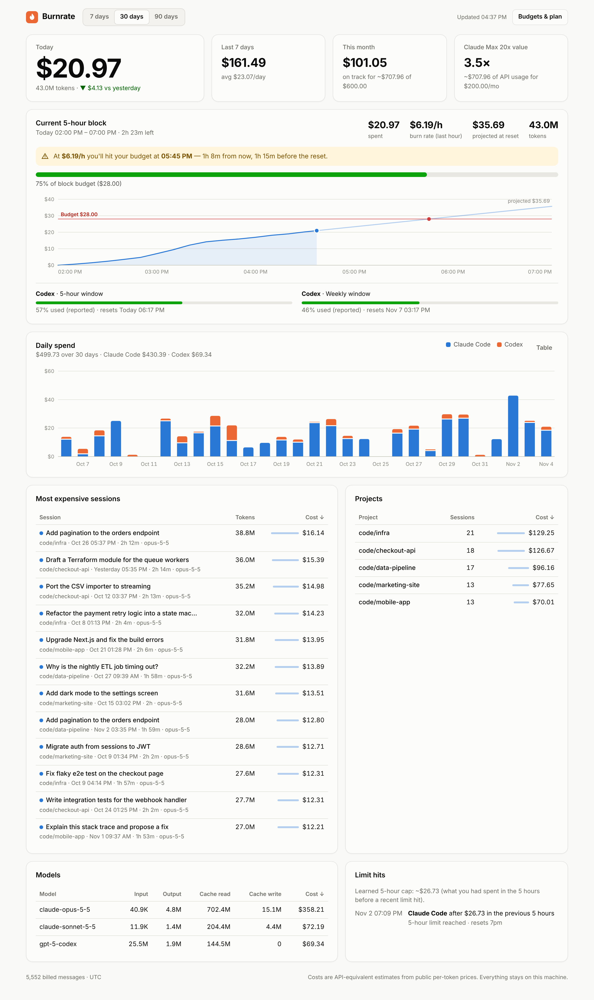

# 🔥 Burnrate

**See what your coding agents really cost, and when you'll hit the wall.**

Burnrate is a local, zero-dependency spend and quota meter for **Claude Code** and **Codex CLI**. It reads the logs your agents already write and shows:

- a live **5-hour block forecast**: *"At $5.96/h you'll hit your budget at 17:44, 15 minutes before the reset."*
- **attribution** by session (titled by your first prompt), project, model and agent: *"that refactor cost $14.23"*
- **value for money** on subscriptions: *"Claude Max 20x → 3.5× value ($708 of API-equivalent usage for $200)"*
- a **status line** for Claude Code, a **menu-bar** plugin, a terminal summary and CSV export

```bash
npx burnrate-cli      # opens http://127.0.0.1:4317
npx burnrate-cli demo # try it with 30 days of synthetic data
```



> Nothing leaves your machine: no account, no API key, no telemetry. The dashboard binds to `127.0.0.1` only.

---

## Why the numbers are right

Most usage calculators over-count. Claude Code writes **one log line per content block, each repeating the same `usage`**. In a real session we measured 228 assistant lines for 92 actual API responses, so naive summing inflates cost about 2.5×. Prompt-cache writes also cost **1.25× input for the 5-minute TTL and 2× for the 1-hour TTL**, and web searches cost $10 per 1,000.

Burnrate deduplicates by `message.id + requestId` and prices every component. Its test suite reproduces Claude Code's own recorded `cost-state` for a real session **to the 7th decimal place** ($15.0607934 Opus + $1.1404568 Haiku). See [`tests/pricing.test.ts`](tests/pricing.test.ts).

## Install

```bash
npm i -g burnrate-cli    # installs the `burnrate` command (or use npx burnrate-cli)
```

Requires Node 20+. Works on macOS, Linux and Windows.

## Commands

| Command | What it does |
|---|---|
| `burnrate` | Scan logs and open the dashboard |
| `burnrate status` | Today, 7 days, month and projection, current block meter and forecast, top sessions |
| `burnrate statusline` | One line for Claude Code's status line (reads its JSON on stdin) |
| `burnrate bar` | xbar / SwiftBar menu-bar output |
| `burnrate sessions [--days 30] [--limit 20]` | Most expensive sessions |
| `burnrate export [--csv\|--json] [--days 30]` | Per-message usage with cost |
| `burnrate budget --block 40 --week 300 --month 1000` | Set budgets (`--clear` to remove) |
| `burnrate plan claude-max-20x` | Set your subscription to see the value multiple (`--name X --usd N` for custom) |
| `burnrate watch` | Desktop notifications at 80% and 100% of any budget |
| `burnrate demo` | Dashboard on synthetic data; your real data is untouched |
| `burnrate scan` / `reset` / `serve --port N` | Utilities |

Global options: `--path <dir>` (repeatable; prefix `codex:` for Codex logs), `--home <dir>`, `--no-titles`, `--no-color`.

### Claude Code status line

Add to `~/.claude/settings.json`:

```json
{ "statusLine": { "type": "command", "command": "burnrate statusline" } }
```

```
◆ $3.12 session · $20.97 today · 75% block · $5.96/h · limit ~17:44
```

### macOS menu bar (xbar / SwiftBar)

```bash
cp integrations/burnrate.1m.sh ~/Library/Application\ Support/xbar/plugins/
```

```
🔥 $20.97 75% ⚠︎
```

## How limits work

Vendors don't publish exact subscription quotas, so Burnrate combines three signals:

1. **Your budget:** `burnrate budget --block 40` or *Budgets & plan* in the dashboard.
2. **Learned caps:** when a "limit reached" message appears in your Claude Code logs, Burnrate records how much you had spent in the 5 hours before it. With no budget set, it uses the smallest of your last three hits as the cap.
3. **Reported limits:** Codex logs its own 5-hour and weekly used-percentages and reset times, and Burnrate shows them as-is.

**Blocks** start at your first message after the previous block ended, floored to the hour, and last 5 hours. **Burn rate** is the spend over the last hour of the active block. The forecast is `now + (budget − spent) / burn rate`.

## Data & privacy

| What | Where |
|---|---|
| Claude Code logs (read-only) | `~/.claude/projects/**/*.jsonl` (+ `$CLAUDE_CONFIG_DIR`), subagents included |
| Codex CLI logs (read-only) | `~/.codex/sessions/**/*.jsonl` (+ `$CODEX_HOME`) |
| Burnrate's cache & config | `~/.burnrate/` (`$BURNRATE_HOME`): `events.ndjson`, `state.json`, `meta.json`, `config.json`, optional `prices.json` |

Burnrate stores token counts, timestamps, model, project path and the **first 80 characters of each session's first prompt** (as its title). Use `--no-titles` to skip titles. Scans are incremental (byte offsets per file), so refreshing costs milliseconds.

**Custom prices.** Costs are *API-equivalent estimates* from public per-token prices (see [`src/pricing.ts`](src/pricing.ts)). To add or override a price, create `~/.burnrate/prices.json`:

```json
{ "my-model": { "input": 1, "output": 4, "cacheRead": 0.1 } }
```

## Development

```bash
npm install
npm test           # vitest: pricing, parsers, incremental store, blocks & forecast
npm run build      # tsc → dist/, copies the dashboard
node dist/cli.js demo
```

```
src/
  cli.ts            commands
  parsers/          claude.ts · codex.ts — defensive line parsers
  store.ts          incremental ingest, dedupe, ~/.burnrate cache
  pricing.ts        price table + cost engine
  aggregate.ts      totals, 5-hour blocks, forecast, learned caps, breakdowns
  server.ts         localhost dashboard API (DNS-rebinding + CSRF guarded)
  dashboard/        index.html · styles.css · app.js (vanilla, hand-built SVG charts)
  demo.ts           deterministic synthetic logs in both formats
```

Docs: [Product requirements](docs/PRD.md) · [Design](docs/DESIGN.md)

**Releasing.** Bump `version` in `package.json` and push to `main`. The release workflow publishes to npm with provenance (trusted publishing, or an `NPM_TOKEN` secret), then creates the tag and GitHub release.

## License

MIT
