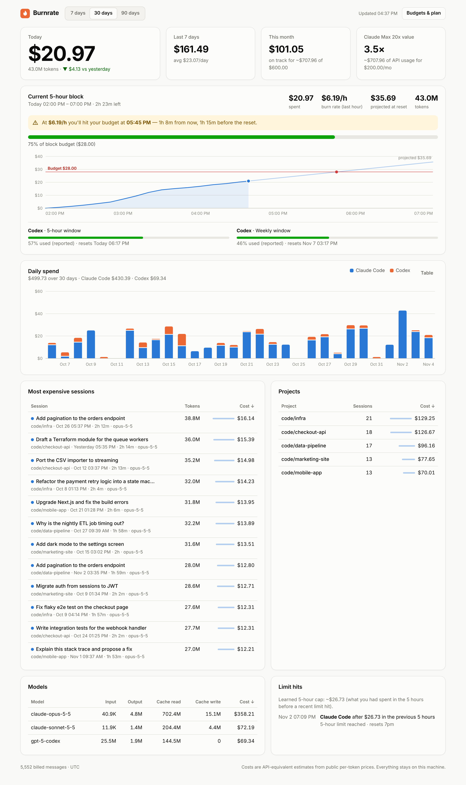
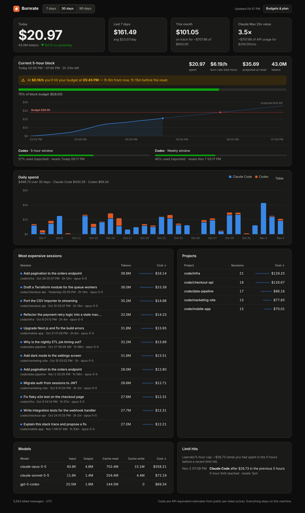
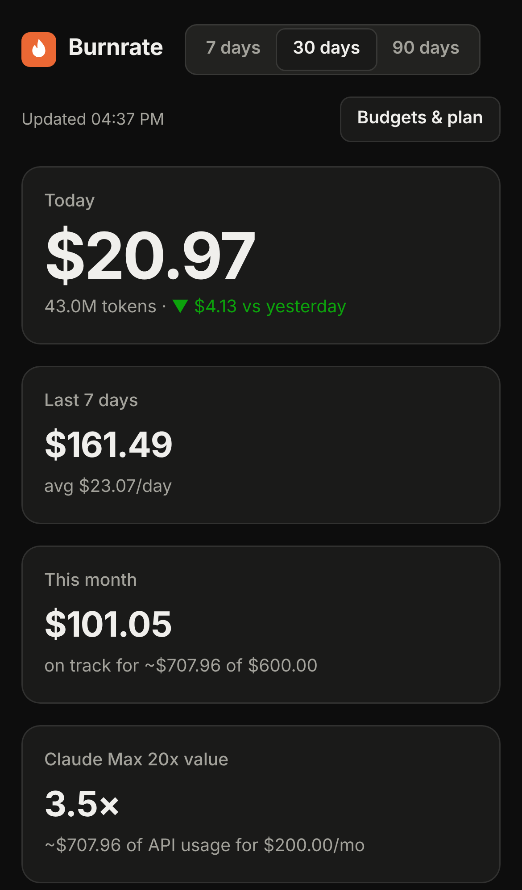

# Burnrate — Design

Burnrate is a developer instrument: it should feel like a well-made gauge, not a marketing page. The number comes first, everything else supports one decision ("can I keep going?"), and every chart follows a validated data-viz method.

| Light | Dark | Mobile |
|---|---|---|
|  |  |  |

## Principles

1. **One hero number.** Today's spend, at 56px, is the only display-size figure on the page.
2. **Forecast over history.** The 5-hour block card leads the page with a sentence ("At $5.96/h you'll hit your budget at 17:44"), a meter and a cumulative chart with a budget line and projection.
3. **Honest estimates.** Costs are labelled API-equivalent, unknown models carry an "unpriced" pill, and Codex percentages are labelled "(reported)".
4. **Quiet chrome.** System sans, hairline borders, no decoration; colour is reserved for data and state.

## Tokens

The chart roles come from the data-viz reference palette. Both modes were run through the palette validator, and every check passed:

| Role | Light | Dark |
|---|---|---|
| Page / chart surface | `#f9f9f7` / `#fcfcfb` | `#0d0d0d` / `#1a1a19` |
| Ink / secondary / muted | `#0b0b0b` / `#52514e` / `#6e6c66` | `#f0efec` / `#c3c2b7` / `#a3a29b` |
| Gridline / baseline | `#e1e0d9` / `#c3c2b7` | `#2c2c2a` / `#383835` |
| Series 1: Claude Code | `#2a78d6` | `#3987e5` |
| Series 2: Codex | `#eb6834` | `#d95926` |
| Status good / warning / critical | `#0ca30c` / `#fab219` / `#d03b3b` | same |

Validator results for the 2-series palette: light has worst adjacent CVD ΔE 24.7 and normal-vision ΔE 33.6; dark has 26.8 and 31.8. All slots are at least 3:1 against the surface.

## Charts

- **Daily spend:** stacked columns by agent, at most 24px wide, with a 4px rounded data-end and a square baseline. A 2px surface gap separates segments. A legend is always shown for two or more series. Each column is its own hover and focus target with a tooltip (value first, line keys), and a **Table** toggle gives the same data without hovering.
- **Block chart:** a 2px cumulative line with a 10% area wash and an end dot with a 2px surface ring. The projection uses the same hue at 35% opacity. The budget is a red reference line with a text label, and a red dot marks where the budget will be hit. A crosshair snaps to the nearest 10-minute bucket.
- **Meters:** fill colour carries severity (good → warning → critical) on a neutral track, always paired with a text label ("75% of block budget ($28.00)").
- **Tables:** sortable by click or Enter, with `aria-sort`, tabular numerals, and an inline bar for relative cost.

## Interaction & accessibility

- Filters (7, 30 or 90 days) sit in one row above everything and scope every number. The choice is remembered in `localStorage`.
- While refreshing, the page keeps its previous render at reduced opacity, with no skeleton flash. It auto-refreshes every 30 seconds while visible.
- All labels come from logs, so they are inserted with `textContent`, never `innerHTML`. A strict CSP (`default-src 'self'`) blocks inline scripts.
- Keyboard: chart columns are focusable and show the tooltip on focus; table headers are sortable with Enter; the settings dialog is a native `<dialog>`.
- Status is never colour-only: alerts carry an icon and text, and meters carry a percentage label.
- `prefers-reduced-motion` disables transitions.

## Terminal surfaces

- `status`: coloured meters (green, then yellow at 80%, red at 100%), respecting `NO_COLOR` and non-TTY output.
- `statusline`: `◆ $3.12 session · $20.97 today · 75% block · $5.96/h · limit ~17:44`, short enough for an 80-column status bar.
- `bar`: a compact menu-bar title (`🔥 $20.97 75% ⚠︎`) with a dropdown of totals, block and top sessions.
